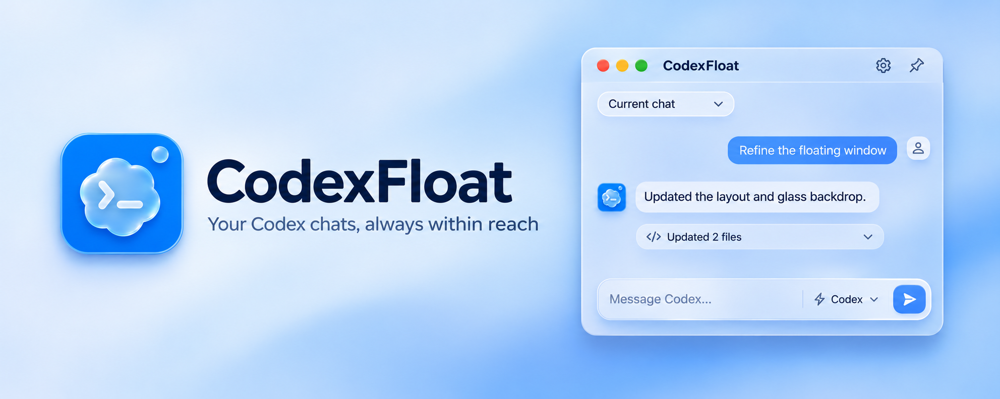

# CodexFloat



English | [简体中文](README.zh-CN.md)

A compact, always-on-top chat window for your existing local chats in the Codex desktop app. Built with Tauri, React, and Rust.

Windows has been tested locally. macOS has been verified on Apple Silicon through live and simulated checks. See the [macOS acceptance record](docs/macos.md) for coverage. The interface is currently in Simplified Chinese.

## Features

| Feature | How to use it |
| --- | --- |
| Browser context | Browser context reads accessible text from the active tab in each supported window (default limit of 32,000 characters; read counts and truncation are displayed). Added browser contexts follow tab changes about every two seconds and remain attached for subsequent messages. Pause to freeze a snapshot, or remove to stop following. Updates apply to future sends, not past messages. On macOS, body extraction requires the browser's automation JavaScript permission; otherwise only URL metadata is available. |
| Composer predictions | Independent composer predictions suggest a follow-up after a new reply finishes. Tab accepts an editable draft; Esc dismisses it. Typing or changing chats cancels pending predictions. Off by default; enable in Settings. Uses the current model and additional quota, not the official free predictions service. Only recent visible chat text is included; attachments and tool outputs are excluded. Connecting to existing history does not generate a prediction. |
| Chat sync and tasks | Live chat history and task status; send prompts, add instructions, and stop tasks. |
| Attachments | Use the paperclip, drag files in, or paste images and copied files. See attachment limits below. |
| Add context | Add file, folder, snippet, browser, IDE, skill, plugin and other-conversation context from the composer’s + button. Search within the selected category, open the snippet editor from Snippet, or add a URL manually from Browser. Use `@` to search context and `$` to search skills; choose with arrow keys and Enter or Tab. Context chips can be removed before sending. |
| Rich messages and diffs | Markdown, images, syntax highlighting, file previews, and per-task file changes with diffs. Audio/video players, citation markers, source cards and attachment cards use the actual synchronized resources. |
| Math and charts | LaTeX math supports `$…$`, `$$…$$`, `\(…\)`, `\[…\]` and `math`/`latex` fences. `mermaid` fences render diagrams; `echarts`/`chart` fences render interactive ECharts JSON options. |
| HTML previews | HTML fences and complete HTML documents offer an isolated preview with expansion that preserves page state. HTTPS resources are supported; local relative resources need accessible URLs. Media playback depends on resource access and browser codec support. |
| Approvals and usage | In-chat approvals and questions, plus account usage indicators. |
| Model and reasoning | Click the model name in the composer to choose an available model and adjust supported reasoning levels with a discrete slider. Releasing the slider saves the selection automatically for subsequent turns. |
| Response speed | Click the lightning button beside the model name to toggle fast responses on or off, or use `/fast` to toggle. Fast tiers come from the current account's model catalog. Changes save automatically for the next turn; fast responses consume usage or credits more quickly. |
| Tool call details | While a task runs, only its latest tool call appears as a single truncated line. Command previews show the command and its arguments without PowerShell launcher paths. Click the line to inspect arguments, output, errors, duration and exit codes. Sections show their complete contents and can be collapsed; only the window body scrolls. Use Close or Escape to dismiss. Completed calls remain in the collapsed work history. |
| MCP App cards | Standard MCP App cards render in chat with resource access, direct tool calls, theme updates, resizing and expansion. Card buttons call tools on the originating MCP server; tool visibility and connector/account scopes are enforced. Results, structured content and widget metadata return to the card. Form requests and web authorization can be handled in the card. Tool connections use temporary threads without creating a model turn or resuming the user's chat; uncertain executions are never retried automatically. Follow-up messages are staged in the composer. Main-app-only card formats still require the main app. |
| Commands and skills | Type `/` at the start of the composer to search commands and enabled skills. Use arrows and Enter/Tab to select, or Escape to close. Commands include `/model`, `/permissions`, `/skills`, `/mention`, `/plan`, `/agent`, `/compact` and `/status`. `$` opens a dedicated skill menu; selected skills become removable context chips. Compact is available only while the chat is idle. |
| Plans and steps | Expand supplied proposed plans and task steps directly in the transcript, with streaming updates. Each turn keeps its latest plan snapshot and completion count; interrupted or failed tasks retain the recorded step statuses. |
| Subagent progress | Per-turn subagent cards show names, tasks, models and current states, expandable results or errors, and links to the corresponding chats in the main app. Completed spawn or wait calls do not imply that a child finished; missing terminal states remain unconfirmed. |
| Work history | Progress updates remain visible during execution. Completed turns fold ordinary commentary, task plans and subagent progress into expandable work details, keeping final answers, async delivery and subagent errors visible. Interrupted and failed turns retain their progress. |
| Copy and edit messages | Copy message source text or individual code blocks with dedicated buttons. Original user messages can be edited and resent with their attachments preserved. During a task, submitting an edit stops the active turn before regenerating subsequent content. Reasoning summaries are hidden in the transcript, while plans and subagent cards remain visible. |
| Planning mode | Use `/plan` to switch to planning and `/agent` to return to execution. Changes take effect on the next turn. |
| Fork a chat | Completed rounds offer a hover-visible fork action beside the user message and final reply. Forks include that round and earlier history, preserve the original chat and unsent composer content, and open in the main app before connecting. Connection retries reuse the created fork. Chat forks share the working directory and do not isolate workspace files. |
| Themes and appearance | Light and dark themes. Background controls depend on the active platform material. |
| Floating status ball | A compact floating status ball that restores the chat when clicked. |
| Permission status | The composer shows current permissions synced from the main app as read-only text. Hover to inspect different next-turn settings. Change permissions in the main Codex app; `/permissions` only displays chat status. |
| Platform materials | On macOS 26+, Settings and Add Context use the native Liquid Glass backdrop when available. Windows uses a shared translucent background for pickers and expanded previews, with blur on the floating status ball. |

## Not yet supported in floating chats

| Feature | Current limitation |
| --- | --- |
| Start a blank chat | Create the chat in the Codex desktop app, then select it in CodexFloat. Forking an existing turn is supported. |
| Built-in dictation and live voice chat | The floating composer has no microphone or voice chat controls. |
| Edit steering messages | Only original user messages can be edited and resent. |
| Compact while a task is running | Run `/compact` once the chat is idle. |
| Reasoning summaries | The floating transcript hides reasoning summaries. Task plans and subagent progress are visible. |
| Main-app-only dialogs and cards | Use the Codex desktop app for sign-in, unsupported dialogs, and MCP card formats specific to the main app. |

## Usage

1. Keep the Codex desktop app running.
2. Launch CodexFloat and select an existing chat. If it is not loaded, CodexFloat opens it in Codex and retries synchronization. Use the sync button to reconnect if needed.
3. Press **Enter** to send or **Shift+Enter** for a new line. Sending during a task adds instructions to that task.

Use the title bar to move or pin the window. macOS uses native traffic-light window controls: yellow minimizes to the Dock, and the circle button at the top right switches to the floating status ball. On Windows, the minimize button switches to the status ball.

## Build

Use Node.js 24 and Rust stable, plus the native prerequisites below. Run commands from the repository root.

### Windows

Requires the MSVC toolchain, Microsoft C++ Build Tools, Windows SDK, and WebView2.

```powershell
npm.cmd ci
npm.cmd run build:windows
```

Output: `src-tauri/target/release/codex-float.exe`.

### macOS (experimental)

Requires macOS 13+, Xcode Command Line Tools, and a Mac to build.

```bash
npm ci
npm run build:macos
```

Output: `.app` and `.dmg` bundles under `src-tauri/target/release/bundle/`. Current builds use ad-hoc signing; public distribution needs signing and notarization.

For development, use `npm run dev:windows` or `npm run dev:macos`. Run frontend tests with `npm test` and native tests with `cargo test --manifest-path src-tauri/Cargo.toml`.

## Limitations

- Uses the desktop app's internal local IPC protocol, which may change with app updates. Existing local chats connect through the desktop app; selecting an unloaded chat opens it there first and may bring its window forward.
- Add attachments using the paperclip inside the composer, drag files in, or paste images and copied files. Each attachment can be up to 25 MB, with up to 20 per message. Clipboard content is saved in the app data directory; attachments are passed to the local chat as file paths.
- Handle sign-in or unsupported dialogs in the main Codex app. Prompts inherit the selected chat's settings.
- Browser context reads each window’s current page and accessible selected text on Windows (Chrome, Edge, Brave and Firefox), with a manual URL/selection entry available. IDE context requires a connected Codex IDE extension. Folders are sent as references, and only enabled skills and plugins are listed. Other conversations can be searched by title, project or ID and sent as live references for Codex to read, without switching the current conversation.
- macOS 26+ uses native Liquid Glass with a Vibrancy fallback on older systems. Settings shows Liquid Glass when active.
- Executables and build caches are excluded from Git. Build the app from source.

## Documentation

The detailed documentation is currently in Chinese:

- [Build instructions and CI](docs/build.md)
- [Project structure](docs/architecture.md)
- [macOS status and validation](docs/macos.md)
