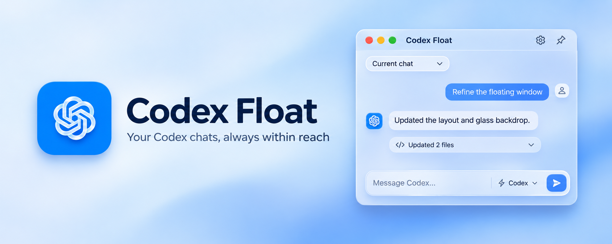

# Codex Float



[English](README.md) | 简体中文

连接 Codex 桌面端已有本地聊天的窄幅置顶窗口，基于 Tauri、React 和 Rust 构建。

Windows 已在本机验证。macOS 已在 Apple Silicon 上完成实机与模拟验收，范围见 [macOS 验收记录](docs/macos.md)。当前应用界面为简体中文。

## 功能

| 功能 | 用法与说明 |
| --- | --- |
| 聊天同步与任务 | 实时同步聊天与任务状态，支持发送提示词、追加指令和停止任务。 |
| 附件 | 在输入框左下角添加附件，支持拖入文件、粘贴截图或复制的文件；可只发送附件。单个附件最大 25 MB，每次最多 20 个。 |
| 输入预测 | 新回复结束后可显示灰色输入预测，Tab 填入可编辑草稿，Esc 忽略，输入文字或切换聊天会取消预测。默认关闭，可在设置中开启；独立预测使用当前模型并额外消耗额度，不复用官方免费预测服务。仅使用最近的可见对话文字，不发送附件和工具输出；连接已有历史不会自动生成预测。 |
| 添加上下文 | 输入框左下角的“+”可添加文件、目录、代码片段、网页、IDE、技能、插件与其他对话上下文。搜索框筛选当前分类，点“片段”打开编辑器，网页分类可手动添加网址。输入 `@` 搜索上下文、`$` 搜索技能，方向键选择后按 Enter 或 Tab 添加；每条消息最多 20 项上下文，可在发送前移除。 |
| 富文本与文件差异 | 显示 Markdown、图片、语法高亮、文件预览，以及每轮任务的修改文件和 Diff。支持音频与视频播放、引用标记、来源卡片和文件附件卡片；引用仅链接已同步的真实来源。 |
| 公式与图表 | 数学公式支持 `$…$`、`$$…$$`、`\(…\)`、`\[…\]` 和 `math`/`latex` 代码块。`mermaid` 代码块渲染图表，`echarts`/`chart` 代码块接收 ECharts JSON 配置，支持图例、悬停和缩放等交互。 |
| HTML 预览 | `html`/`html-preview` 代码块或完整 HTML 文档可点击预览，在独立沙箱内运行，支持放大并保留页面状态。HTML 可加载 HTTPS 资源；本地相对资源需改为可访问的地址。媒体实际播放取决于资源可访问性和系统浏览器的编码支持。 |
| 审批、提问与额度 | 在聊天中处理审批与提问，显示账号额度。 |
| 模型与推理强度 | 点击输入框底部的模型名称，在弹窗中选择可用模型，并使用分档滑块调节推理强度；松开滑块后自动保存到当前聊天，从下一轮生效。 |
| 响应速度 | 点击模型名称左侧的闪电按钮，在弹窗中选择标准或快速响应；也可输入 `/fast` 切换。仅展示当前模型与账号提供的快速档位，选择后自动保存、下轮生效；快速模式会更快消耗额度或点数。 |
| 工具调用详情 | 执行中仅显示最新一条工具调用，单行截断。命令预览显示命令及参数，省略 PowerShell 启动器路径。点击打开详情窗口。内部各部分完整显示并可折叠，仅外层滚动；可点击关闭按钮或按 Esc 关闭。任务结束后完整调用保留在默认折叠的工作过程中。 |
| MCP App 卡片 | 标准 MCP App 卡片支持资源加载、按钮直接调用工具、结果同步、主题适配、尺寸调整和放大。工具调用限定在卡片所属的 MCP 服务，校验工具可见性及连接器和账号范围，完整返回文本、结构化结果与卡片元数据。支持在卡片中处理表单请求和网页授权。使用临时工具连接，不恢复原聊天、不启动模型任务；结果不确定时不自动重试。卡片的跟进消息填入输入框后由用户发送。主 App 专用格式仍需在主 App 打开。 |
| 命令与技能 | 在输入框开头输入 `/` 打开命令与技能菜单，可搜索并用方向键、Enter/Tab 选择，Esc 关闭。支持 `/model`、`/permissions`、`/skills`、`/mention`、`/plan`、`/agent`、`/compact`、`/status`；也可直接搜索并添加已启用技能。`$` 打开专用技能菜单，选择后作为可移除的上下文发送。压缩命令仅在聊天空闲时可用。 |
| 计划与步骤 | 消息中同步展示主 App 提供的计划草稿与计划步骤，支持展开收起和流式更新。计划按每轮最新状态合并，显示完成数与各步骤状态；任务中断或失败不会自动把未完成步骤标为完成。 |
| 子代理进度 | 子代理进度卡按每轮任务合并，显示名称、任务、模型和最新状态，支持展开结果或错误、在主 App 打开对应对话。创建完成和等待调用结束不等于子代理完成；缺少最终状态时会保留“状态待确认”。 |
| 工作过程 | 任务执行中展示过程更新；正常完成后，普通过程更新与已结束的计划、子代理进度默认收起到可展开的“工作过程”。最终答复、异步消息和子代理失败信息继续显示；中断或失败的轮次保留过程。 |
| 消息复制与编辑 | 每轮任务完成后，仅在最后一条可见回复右下角显示消息复制按钮，复制该回复原文，不包括用户输入、工具调用和折叠过程；代码块仍有独立复制按钮。已发送的原始用户消息可编辑并重新发送，原附件保留；该消息之后的内容会被重新生成。任务运行时提交编辑会先停止当前任务，再重新发送。思考摘要在聊天中隐藏，计划和子代理进度继续显示。 |
| 计划模式 | 使用 `/plan` 切换计划模式，使用 `/agent` 切回执行模式，选择后下轮生效。 |
| 聊天分叉 | 已完成轮次的用户消息和最后一条回复旁提供“从此轮分叉”，悬停时显示。分叉复制该轮及此前历史，保留原聊天；创建后在主 App 打开并尝试连接，保留未发送的草稿、附件和上下文。连接失败可重试连接已创建的分叉，避免重复创建。分叉沿用工作目录，聊天分叉不会隔离工作区文件。 |
| 主题与外观 | 支持亮暗主题。背景调节选项随当前平台材质而定。 |
| 悬浮状态球 | 可缩小为悬浮状态球，点击恢复聊天窗口。 |
| 平台材质 | macOS 26+ 在原生材质可用时为设置、修改权限、响应速度和添加上下文弹窗使用 Liquid Glass 背景。Windows 的选择弹窗和展开预览共用半透明模糊背景，悬浮状态球也使用模糊效果。 |

## 悬浮窗聊天暂不支持的功能

| 功能 | 当前限制 |
| --- | --- |
| 新建空白聊天 | 先在 Codex 主窗口创建，再在悬浮窗选择该聊天。悬浮窗支持从已有轮次分叉。 |
| 内置语音听写与实时语音对话 | 悬浮窗输入框没有麦克风或语音对话入口。 |
| 单独编辑追加指令 | 目前只支持编辑并重新发送原始用户消息。 |
| 任务运行时压缩上下文 | 聊天空闲后可运行 `/compact`。 |
| 思考摘要 | 悬浮窗隐藏思考摘要，可查看任务计划和子代理进度。 |
| 主窗口专用弹窗与卡片 | 登录、悬浮窗暂不支持的弹窗及主 App 专用 MCP 卡片需在 Codex 主窗口处理。 |

## 使用

1. 保持 Codex 桌面端运行，并在主窗口打开目标聊天。
2. 启动 Codex Float，选择该聊天；需要重新连接时点击同步按钮。
3. **Enter** 发送，**Shift+Enter** 换行。任务执行中发送内容会追加指令。

拖动标题栏移动窗口，图钉切换置顶。macOS 使用系统红黄绿窗口按钮，黄色按钮最小化到 Dock，右上角圆点按钮切换为悬浮状态球；Windows 的最小化按钮切换为悬浮状态球。

## 构建

需要 Node.js 24、Rust stable 和对应平台的原生构建依赖。在项目根目录执行以下命令。

### Windows

需要 MSVC 工具链、Microsoft C++ Build Tools、Windows SDK 和 WebView2。

```powershell
npm.cmd ci
npm.cmd run build:windows
```

产物：`src-tauri/target/release/codex-float.exe`。

### macOS（实验性）

需要 macOS 13+、Xcode Command Line Tools，并在 Mac 上构建。

```bash
npm ci
npm run build:macos
```

`.app` 和 `.dmg` 产物位于 `src-tauri/target/release/bundle/`。当前使用 ad-hoc 签名，公开发布前需配置正式签名与公证。

开发模式使用 `npm run dev:windows` 或 `npm run dev:macos`。前端测试使用 `npm test`，原生测试使用 `cargo test --manifest-path src-tauri/Cargo.toml`。

## 限制

- 使用桌面端内部的本地 IPC 协议，可能随 App 更新变化；仅能连接已有运行实例的本地聊天。
- 登录及不支持的弹窗仍需在 Codex 主窗口处理。发送内容沿用所选聊天的设置。附件通过本地文件路径交给该聊天，粘贴内容保存在应用数据目录。
- 网页上下文读取各浏览器窗口当前标签页，Windows 支持 Chrome、Edge、Brave、Firefox 的地址与可访问正文。添加后约每 2 秒跟随该窗口当前标签页，标签在发送后保留，后续发送时包含最新快照；可暂停固定内容或移除。不会改写已发送消息。正文读取默认上限为 32,000 字符；显示当前读取字符数及截断状态；未加载、浏览器未提供的内容无法读取，读取失败会明确提示。macOS 的正文读取需要浏览器允许自动化 JavaScript，否则保留网址；不会替用户开启该浏览器设置。也可手动添加网址和选中文本。IDE 上下文需要对应项目中已连接的 Codex IDE 扩展；技能、插件列表仅展示已启用项目。目录作为路径引用发送，不会一次性展开所有文件。其他对话可按标题、项目或 ID 搜索，作为实时引用发送，由 Codex 按需读取，不会切换当前聊天。
- macOS 26+ 使用原生 Liquid Glass，旧系统自动回退为 Vibrancy。启用 Liquid Glass 时，设置面板会显示材质说明。
- Git 不包含可执行文件和构建缓存，请从源码构建。

## 文档

- [构建说明与 CI](docs/build.md)
- [项目结构](docs/architecture.md)
- [macOS 状态与验收](docs/macos.md)

子代理卡片的“查看并操作”可查看已同步的对话和工具记录，每 4 秒刷新；运行中可追加指令或单独停止，已结束但仍可连接的子代理可发送指令开始下一轮。停止绑定具体轮次；切换父聊天后关闭操作面板。未连接或已关闭的子代理需先在主 App 打开对应对话。

工具调用的完整历史保留在同步数据中；执行期间只显示最新一条，任务结束后收进折叠的工作过程。展开过程并点击调用摘要，可按原始顺序选择调用，独立复制参数、命令、输出和结果。详情内容完整展示或折叠，不使用内嵌滚动条。

聊天过程按同步流原始顺序显示说明消息及最新工具调用；旧调用的状态更新不会取代最新调用。完成后普通过程收进“工作过程”，最终回复单独保留，任务结束后所有工具调用（含失败、拒绝和中断）均收进“工作过程”，外部不单独显示，可展开查看。执行过程中不显示“搜索与筛选本轮调用”入口。

“工作过程”展开后保持消息与工具调用的原始时间顺序，摘要显示本轮总耗时。优先采用同步数据中的 durationMs，否则使用协议提供的开始、结束时间差；无可靠计时数据时显示“未提供”，不会累加并发工具耗时。

思考动画下方不再重复显示命令。执行期间的最新工具调用在消息流中显示为一行，超长截断，点击打开工具详情窗口；同时只显示一个调用窗口。任务结束后，全部调用收进“工作过程”。

任务完成后的过程区按参考截图显示为“上 N 条消息”与细分隔线，默认折叠，点击可展开；保留本轮用时。正文无左侧竖线或额外缩进，相邻工具调用合并成灰色摘要，点击弹窗可按原始顺序选择各次调用，查看完整参数和输出。
