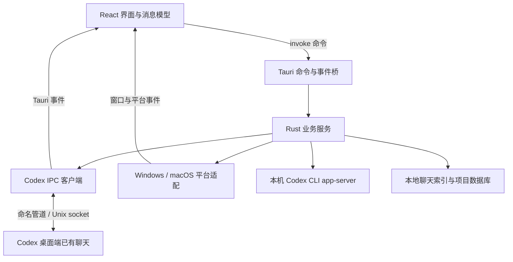
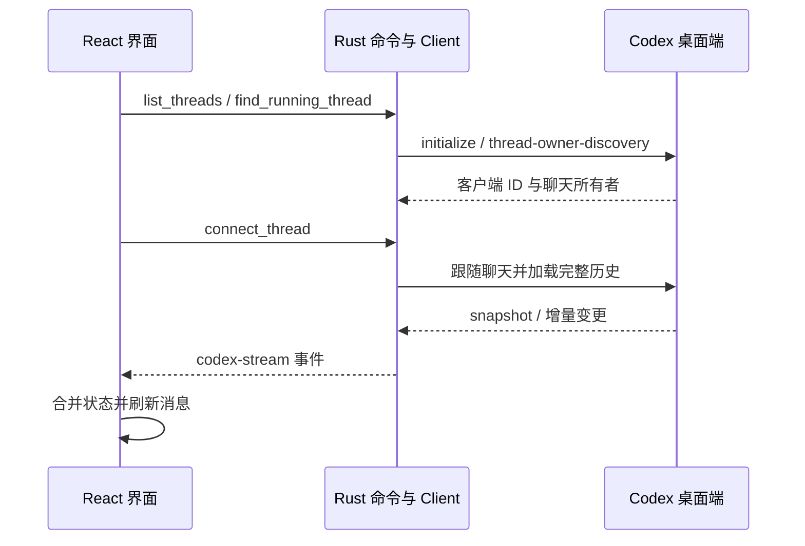

# CodexFloat 组件与应用架构

本文基于当前仓库代码整理，应用版本为 `0.1.4`，更新日期为 2026-11-08。依赖版本采用清单中的声明范围，实际解析版本以 `package-lock.json` 和 `src-tauri/Cargo.lock` 为准。

## 1. 应用定位

CodexFloat 是连接 Codex 桌面端已有本地聊天的悬浮窗口，支持 Windows 和 macOS。用户可以在窄幅置顶窗口中查看消息、发送提示词、处理审批、添加附件，以及切换为迷你状态球。

应用复用 Codex 桌面端的聊天运行实例，通过本地 IPC 同步消息和任务状态。登录、聊天运行和模型执行主要由 Codex 桌面端负责；部分辅助功能会启动本机 Codex CLI 的 `app-server --stdio` 子进程。输入预测也使用独立的临时模型请求，会额外消耗额度。

当前界面支持简体中文和英文。ChatGPT 相关实验文件仍保留在仓库中，但窗口没有挂载对应入口，Rust 端也没有注册相关命令，因此不属于当前启用的聊天通道。

## 2. 总体结构

| 层级 | 主要位置 | 职责 |
| --- | --- | --- |
| 界面层 | `src/*.jsx`、`src/platform/` | 聊天、输入、设置、弹窗和平台窗口布局 |
| 前端数据模型 | `src/*.js` | 消息转换、增量合并、任务状态、附件、交互格式和本地偏好 |
| 应用装配层 | `src-tauri/src/app.rs` | 注册 Tauri 命令、共享状态、单实例插件和退出清理 |
| 聊天协议层 | `src-tauri/src/codex/` | 索引读取、运行实例发现、请求关联、历史加载和流订阅 |
| 业务服务层 | `src-tauri/src/services/` | 附件、上下文、模型设置、MCP 卡片、分叉和窗口模式等功能 |
| 平台层 | `src-tauri/src/platform/` | 原生窗口、系统材质、IPC 端点、剪贴板、浏览器和 CLI 进程差异 |

前端平台入口在运行时选择；Rust 平台模块通过 `target_os` 条件编译选择。Windows 的 Win32/WinRT 依赖与 macOS 的 AppKit/Objective-C 依赖分别放在 Cargo 的平台依赖段中。

## 3. 使用的技术组件

### 3.1 前端依赖

来源：[package.json](../package.json)。

| 组件 | 声明版本 | 在项目中的作用 |
| --- | --- | --- |
| React、React DOM | `^19` | 组件渲染、Hooks 状态管理、上下文和窗口 UI 更新 |
| Vite | `^7` | 本地开发服务、前端资源编译与生产打包 |
| `@tauri-apps/api` | `^2` | 从前端调用 Rust 命令，监听后端事件和操作原生窗口 |
| `lucide-react` | `^0.468` | 同步、聊天、附件、工具等界面图标 |
| `marked` | `^16` | Markdown 解析 |
| `dompurify` | `^3` | 清理渲染内容中的不安全 HTML |
| `highlight.js` | `^11.12.0` | 代码语法高亮 |
| KaTeX | `^0.19.1` | 数学公式渲染 |
| Mermaid | `^12.3.0` | Mermaid 图表预览 |
| ECharts | `^6.1.0` | 基于 JSON 配置的交互图表预览 |
| `fast-json-patch` | `^3` | 应用聊天流中的 JSON Patch 增量更新 |
| jsdom | `^30.1.3` | 为前端组件测试提供 DOM 环境，生产运行不依赖它 |
| `@tauri-apps/cli` | `^2` | 开发启动、原生编译和安装包生成 |

界面使用项目自己的 JSX 组件、SVG 图标和 [fluent.css](../src/fluent.css)，视觉样式参考 Fluent；并未引入 Fluent UI 组件库。当前状态管理主要使用 React Hooks、Context、Ref 与纯函数模块，没有引入 Redux 等独立状态管理框架。

### 3.2 Rust 与原生依赖

来源：[Cargo.toml](../src-tauri/Cargo.toml)。

| 组件 | 声明版本 | 在项目中的作用 |
| --- | --- | --- |
| Tauri、`tauri-build` | `2` | 桌面窗口、WebView 宿主、命令桥和构建资源生成 |
| `tauri-plugin-single-instance` | `2` | 再次启动时唤起已有窗口，避免重复运行多个主实例 |
| Tokio | `1` | 本地异步传输、读写、消息通道、任务与超时 |
| Serde、`serde_json` | `1` | 命令参数和聊天协议 JSON 序列化 |
| `rusqlite` | `0.41.1`，启用 `bundled` | 读取本地 Codex 项目与聊天元数据，补充列表分组信息 |
| `rfd` | `0.17` | 系统文件和目录选择对话框 |
| `walkdir` | `2` | 上下文文件搜索时遍历目录 |
| `uuid` | `1` | 请求 ID、客户端消息 ID、临时资源标识及聊天 ID 校验 |
| `base64` | `0.22` | 图片和资源数据编码、解码 |
| `windows-sys`、`windows` 及配套 crate | `0.61` / `0.62` 等 | Windows 原生窗口、DWM、Composition、剪贴板与系统交互 |
| `resvg` | `0.45.1` | Windows 原生标题栏操作图标的 SVG 光栅化 |
| `objc2`、`objc2-app-kit`、`objc2-foundation`、`block2`、`libc` | 见 Cargo 清单 | macOS AppKit 窗口、工具栏、材质、事件与系统调用 |

Windows 使用系统 WebView2 承载界面，macOS 使用 WKWebView。React 页面负责大部分内容，原生代码负责需要 OS 能力的窗口和平台行为。

## 4. 主要界面组件

| 组件或模块 | 职责 |
| --- | --- |
| [main.jsx](../src/main.jsx) | 初始化主题、语言和透明度，根据原生平台选择窗口入口 |
| `WindowsWindow.jsx`、`MacOSWindow.jsx` | 对接平台窗口外壳，组合设置、聊天和迷你球 |
| [useWindowSession.js](../src/platform/useWindowSession.js) | 协调窗口与状态球切换、原生模式恢复、滚动位置和焦点 |
| [SessionView.jsx](../src/SessionView.jsx) | 聊天主容器，管理连接、消息流、草稿、发送、同步和编辑操作 |
| `ThreadPicker.jsx`、`thread-groups.js` | 按项目分组显示聊天列表并处理选择 |
| `Markdown.jsx`、`CodePreview.jsx`、`RichPreview.jsx` | Markdown、代码、公式、图表与 HTML 预览 |
| `ToolDetails.jsx`、`WorkDetails.jsx`、`ChangedFiles.jsx`、`DiffPreview.jsx` | 工具调用详情、工作过程、修改文件和差异展示 |
| `InteractionMessages.jsx`、`QuestionAnswer.jsx` | 审批、提问和已提交答案展示 |
| `ModelPicker.jsx`、`ReasoningSlider.jsx`、`PermissionPicker.jsx`、`SpeedPicker.jsx` | 模型、推理强度、权限和响应速度设置 |
| `ComposerAttachments.jsx`、`ContextPicker.jsx`、`SlashMenu.jsx` | 附件、上下文、命令和技能选择 |
| `McpAppCard.jsx`、`McpToolApproval.jsx` | MCP App 的嵌入式卡片、工具交互和卡片审批 |
| `MessageActions.jsx`、`ForkMessageDialog.jsx` | 消息复制、编辑重发和聊天分叉 |
| `Settings.jsx`、`MiniStatus.jsx`、`AccountUsage.jsx` | 外观与语言设置、迷你状态球和额度展示 |
| [i18n.js](../src/i18n.js)、`locales/en.js` | 中英文文本切换和语言偏好保存 |

`SessionView` 保存当前会话的 UI 状态；`model.js` 等纯函数模块负责把原始聊天数据转换为可显示的消息、任务与工具记录。原始同步数据和展示结果分开处理，因此界面折叠工作过程、隐藏思考摘要，不需要丢弃原始工具历史。

## 5. 聊天连接与消息流

### 5.1 本地索引与运行实例是两种数据

[index.rs](../src-tauri/src/codex/index.rs) 从 Codex 数据目录读取 `session_index.jsonl`，并结合项目元数据和 `models_cache.json` 组织聊天列表。默认数据目录为用户目录下的 `.codex`，可通过绝对路径 `CODEX_HOME` 覆盖。

索引中有某条聊天记录，只代表它存在于本地历史中，不代表桌面端当前持有它的运行实例。

用户手动选择聊天或点击同步时，`connect_thread` 先发现所有者；只有返回 `no-client-found` 才通过 `codex://threads/<id>` 在主 App 打开该已有聊天，并在最多约 8 秒的等待预算内重试所有者发现。随后加载历史并订阅实时流，不发送提示词。会话链接可能使主窗口切换到前台。后台启动发现和自动重连不主动打开窗口；管道错误、超时等其他错误也不触发打开。

启动时，如果存在父 Codex 进程提供的 `CODEX_THREAD_ID`，界面优先连接该聊天。独立启动没有此变量时，前端调用 `find_running_thread`，依次检查上次选择及当前索引候选，通过 `thread-owner-discovery` 寻找可用的所有者。候选范围来自当前返回的聊天列表，并非枚举桌面端全部历史。

[discovery.rs](../src-tauri/src/codex/discovery.rs) 会跳过无效 ID、重复项及返回 `no-client-found` 的聊天；连接中断和其他协议错误会保留，避免把所有错误都解释为“聊天未打开”。

### 5.2 连接与订阅

[client.rs](../src-tauri/src/codex/client.rs) 负责传输和请求生命周期：

- Windows 默认连接 `\\.\pipe\codex-ipc`，macOS 使用 Unix socket；平台传输模块支持 `CODEX_FLOAT_IPC_PATH` 覆盖端点。
- 每条传输消息使用 4 字节小端长度头加 JSON 数据体；请求通过 UUID 与等待中的响应关联。
- 建立连接后初始化客户端，再查找目标聊天所有者、订阅状态并请求历史。
- 后端把选中聊天的流变更发送为 `codex-stream`，连接关闭则发送 `codex-disconnected`。
- 前端使用快照和 JSON Patch 合并状态，发现无法合并的变更时重新同步。

未连接提示下方的“同步聊天”按钮与右上角同步按钮共用 `syncCurrentThread`：先刷新列表，再连接当前选中的聊天。同步过程中按钮禁用并显示旋转图标。

### 5.3 发送、设置与辅助通道

普通消息通过 `send_prompt` 转换为当前聊天的启动下一轮或追加指令请求，交给聊天所有者处理。前端会维护乐观消息，并用实际流中的回声确认发送；结果不确定时不会自动重发。

其他能力按业务拆分到 `services/`：

| 服务 | 主要用途 |
| --- | --- |
| `attachments.rs`、`context.rs` | 附件检查、粘贴内容保存、上下文搜索和发送参数组织 |
| `attachment_cache.rs` | 粘贴附件缓存的保留期限、容量限制和启动清理 |
| `model_settings.rs`、`permissions.rs`、`speed_settings.rs` | 查询可用选项并更新当前聊天设置 |
| `catalog.rs`、`usage.rs` | 查询技能、插件和额度等辅助信息 |
| `interactions.rs`、`stop.rs` | 构造交互回复与停止具体任务 |
| `message_actions.rs`、`forks.rs` | 编辑重发、聊天分叉及相关设置处理 |
| `predictions.rs` | 可选的输入预测、取消和子进程生命周期管理 |
| `subagent_actions.rs` | 查看及操作当前聊天关联的子代理 |
| `links.rs` | 链接打开、本地文件预览和文件管理器定位 |

辅助查询和部分操作会通过 CLI 的 stdio 通道完成；实时聊天同步仍走桌面端 IPC。应用不会因为读取了本地聊天索引，就直接从数据库恢复一个可执行的聊天运行实例。

## 6. 窗口、材质与本地状态

### Windows

- [background.rs](../src-tauri/src/platform/windows/background.rs) 优先尝试自定义 Composition 高斯模糊，并协调原生标题栏；不可用时按初始化结果尝试 DesktopAcrylicController、DWM 系统亚克力或旧版 Accent 路径。
- `custom_blur.rs` 实现原生背景模糊与裁剪；前端 CSS 配合主题色和透明度形成当前的玻璃外观。
- `caption.rs` 实现原生标题栏附加操作，并从 EXE 的 ICO 资源按 DPI 加载窗口图标。
- `window.rs` 处理原生尺寸与位置、边框、裁剪及相关窗口事件。
- `build.rs` 监听 `icons` 目录变化，确保更新图标后重新嵌入 EXE 资源。

### macOS

- `toolbar.rs` 与 `drag.rs` 负责 AppKit 工具栏、按钮和拖动行为。
- `background.rs` 根据系统能力选择 Liquid Glass 或 Vibrancy，弹窗材质通过平台能力与前端协调。
- `window.rs` 负责原生窗口事件、设置弹窗效果和状态球相关处理。

可用的背景调节项取决于运行时实际启用的材质；仓库包含某种材质实现，不表示每台设备都会启用该实现。

### 迷你模式与偏好

Rust 的 `MiniModeState` 管理原生模式和正常窗口快照，前端 `useWindowSession` 查询原生状态，避免热更新或重新挂载后把完整聊天布局挤进状态球。模式切换有并发保护；Windows 通过一次原生调用同时调整位置和尺寸，减少中间画面。

主题、语言、外观、输入预测开关和上次聊天选择等轻量偏好保存在前端 `localStorage` 中。开发服务地址与发布版页面属于不同来源，不应假设二者一定共享同一份前端偏好。

## 7. 富内容与边界

普通 Markdown 内容经过解析、清理后展示。图表和 HTML 等需要脚本运行的内容使用专门的预览路径；MCP 卡片使用沙箱 iframe 与宿主消息桥通信。

[mcp_apps.rs](../src-tauri/src/services/mcp_apps.rs) 在 `127.0.0.1` 的动态端口提供临时页面，通过随机 token 标识资源，并检查请求 Host。卡片卸载后释放资源。`mcp_tool_calls.rs` 处理卡片工具调用与请求回复；前端通过 `McpAppCard` 对接资源、主题、尺寸、审批和工具结果。

关键边界包括：Tauri capabilities 与 CSP、iframe sandbox、临时资源作用域、文件和附件检查，以及聊天 ID 与当前绑定校验。正式构建的卡片 / 预览 CSP 只允许 Tauri 页面作为父页面；开发端口仅在 Tauri 开发模式下加入。具体权限以各功能实现为准；这些机制不能被理解为对任意第三方卡片行为的保证。

`open_file` 只允许常见文档、图片、音视频、压缩包及部分源文件类型，并检查解析后的真实路径、可执行文件头，以及 Unix 可执行权限。程序、脚本、快捷方式、应用包和未知类型需在文件管理器中检查后手动打开；“在文件夹中显示”不受此类型限制。

粘贴和拖入 WebView 的内容保存在应用数据目录的 `attachments/<uuid>/`。启动及保存新附件时清理超过 30 天的旧缓存；本次运行新建的缓存受到保护。扫描在锁外完成，删除时逐目录加锁并重新检查保护状态，保存时计入扫描期间新增的文件，避免并发写入突破 512 MiB 上限。单个目录扫描或删除失败会记录日志并继续处理其他目录；不可读目录按单附件最大 25 MB 保守计入额度，缓存根目录本身不可用仍会报错。

达到上限时可在设置中点击“打开附件缓存文件夹”，手动删除不再需要的缓存；下一次粘贴会重新读取占用，无需重启。近期文件不因重启而自动清理。本次运行的缓存只受到自动清理保护，不妨碍用户手动删除。历史消息中的缓存图片被清理后可能无法再预览；用户选择的原始文件不在自动清理范围。清理不遍历符号链接、目录联接和非 UUID 目录。

应用标识改为 `local.codex.float`，系统会为其使用新的应用数据目录。旧标识目录中的偏好和 WebView 数据未自动迁移；已有附件路径保持原样，旧 `attachments` 缓存仍参与启动时的过期清理。缓存清理不会删除这些偏好或 WebView 数据。

桌面聊天使用的是 Codex 内部本地 IPC 协议，协议可能随桌面端升级而变化。需要保持本机 Codex 运行并打开目标聊天；登录和未支持的主 App 专用交互仍在主窗口处理。

## 8. 构建、测试与发布

开发入口为 `npm run dev:windows` 或 `npm run dev:macos`。前端入口是 `src/main.jsx`，原生入口是 `src-tauri/src/main.rs`，后者调用 `app::run()` 装配应用。

| 操作 | 命令 / 说明 |
| --- | --- |
| 安装前端依赖 | `npm ci` |
| 前端生产构建 | `npm run build`，生成工具栏图标资源并输出 `dist/` |
| 前端测试 | `npm test`，使用 Node test runner，部分测试结合 jsdom 与 Vite 加载界面 |
| 原生测试 | `cargo test --locked --manifest-path src-tauri/Cargo.toml` |
| Windows 便携 EXE | `npm run build:windows`；脚本使用 `--no-bundle` |
| Windows 安装包 | 在 Windows 构建环境中执行 `npm run tauri -- build --bundles nsis` |
| macOS App 与 DMG | 在 Mac 上执行 `npm run build:macos -- --bundles app,dmg` |

Windows 构建需要 MSVC、Windows SDK 和 WebView2；项目脚本可加载本地工具链环境。生产 EXE 使用打包后的前端资源，不依赖 Vite 开发服务器。

[GitHub Actions 工作流](../.github/workflows/build.yml) 分别在 Windows x64、macOS Apple Silicon 和 macOS Intel runner 上运行测试和构建。推送 `v*` 标签时，发布任务等待三平台成功，检查四个下载附件，生成 SHA256 校验文件，再创建并公开 Release。

Windows 提供安装 EXE 和便携 ZIP；macOS 各架构仅发布 DMG，DMG 内包含 `.app`。需要单独构建 `.app` 时可使用上表中的本地构建命令。当前发布说明注明 Windows 未使用商业代码签名、macOS 使用 ad-hoc 签名且未公证。

## 9. 阅读代码的建议顺序

1. 从 [main.jsx](../src/main.jsx) 与 [app.rs](../src-tauri/src/app.rs) 了解前后端装配。
2. 阅读 [SessionView.jsx](../src/SessionView.jsx)，跟踪选择聊天、同步、接收事件与发送消息。
3. 阅读 `codex/index.rs`、`discovery.rs`、`commands.rs` 和 `client.rs`，理解历史列表与运行实例的区别。
4. 按功能查看 `services/` 和相应 React 组件，再进入 `platform/` 查看 OS 差异。
5. 结合 `scripts/*.test.mjs` 与 Rust 模块内测试，了解消息确认、聊天切换、模式恢复和错误处理约束。

更多细节可参阅已有的 [项目结构说明](../docs/architecture.md)、[构建与 CI 说明](../docs/build.md) 和 [macOS 验收记录](../docs/macos.md)。新增文档按本次要求放在 `doc/`，已有 `docs/` 目录继续保留。
